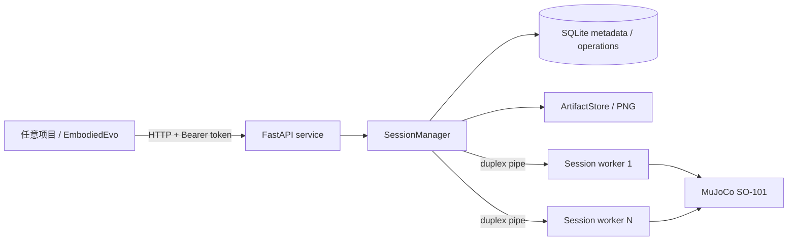

# simulation-runtime

独立、项目化的机器人仿真服务。将 SO-101 / MuJoCo 仿真能力从 EmbodiedEvo 中解耦出来，任何项目都可以通过 HTTP API 或 Python SDK 使用，无需拷贝 EmbodiedEvo 仓库或 MuJoCo 资产。

> 当前版本 `0.1.0`，第一阶段（单机部署、进程级会话隔离）。接口协议：`simulation-runtime/v1`。

## 能力概览

- **后端**：`mujoco_so101`（`pick_cube`，300 步原生动作上限，20 Hz，双 256×256 相机）；`fake`（确定性测试后端）。
- **两种会话模式**
  - `typed`：客户端逐步提交关节或 IK 动作，适合策略/评测循环。
  - `exec`：提交受限 Python 程序，会话内全局变量持久化，适合快速实验。
- **两个阶段**
  - `playground`：允许 `/reset`，每次重置恢复同一 seed 场景并续满原生动作次数。
  - `test`：禁止重置；用于正式评测。
- **多项目接入**：Bearer 项目令牌 → 服务端派生 `project_id`；会话、操作、观测、工件全部按项目隔离。
- **可靠操作**：长操作异步执行（`202` + operation 轮询）、幂等键、超时/崩溃后标记 `outcome_uncertain` 且**绝不重放**动作。
- **观测工件**：相机帧以 PNG 存储，通过带鉴权的 `/v1/artifacts/{id}` 下载；不暴露服务器文件路径。
- **零重依赖 SDK**：`simulation_runtime.sdk` 仅使用标准库；服务端仅需 FastAPI + SQLite。
- **进程隔离**：每个会话独占一个 worker 进程；会话内所有写操作串行化。

## 架构



- `core/`：与后端无关的会话语义（预算、阶段、动作校验、受限执行）。
- `backends/`：`mujoco_so101` 与 `fake`；MuJoCo 模型资产已内置（Apache-2.0，见 `THIRD_PARTY_NOTICES.md`）。
- `service/`：认证、会话管理、worker 进程、SQLite 操作日志、工件、TTL 回收。
- `sdk/`：标准库 HTTP 客户端与同步会话封装。
- `cli.py`：`serve` / `capabilities` / `smoke` / `backend-smoke`。

## 快速开始

要求 Python 3.10+。宿主机需要能创建 OpenGL 上下文（macOS 直接运行；Linux 容器使用 EGL，见 `deploy/`）。

```bash
python -m venv .venv
.venv/bin/pip install -e '.[service,mujoco]'

export SIM_RUNTIME_TOKENS_JSON='[{
  "token": "replace-with-a-random-token-at-least-16-chars",
  "project_id": "demo",
  "scopes": ["playground", "test", "typed", "exec"]
}]'
export SIM_RUNTIME_DATA_DIR="./data"
.venv/bin/simulation-runtime serve
```

服务默认监听 `127.0.0.1:8080`。先验证：

```bash
export SIM_RUNTIME_TOKEN='replace-with-a-random-token-at-least-16-chars'
.venv/bin/simulation-runtime capabilities
.venv/bin/simulation-runtime smoke                 # 使用 fake 后端走完整链路
.venv/bin/simulation-runtime backend-smoke --backend mujoco_so101
```

## Python SDK

```python
from simulation_runtime.sdk import Client

client = Client("http://127.0.0.1:8080", token="...")

with client.session(
    backend="mujoco_so101", task="pick_cube",
    phase="playground", mode="typed", seed=0,
) as session:
    print(session.instruction())
    observation = session.observation()
    print(observation["state"]["ee_pose"])
    session.download_camera(observation, "top_cam", path="top.png")

    result = session.step({
        "ee_position": [0.2, -0.1, 0.10],
        "ee_joint_state": [1.0],
    })
    print(result["success"], result["native_steps_remaining"])
```

受限程序模式：

```python
with client.session(mode="exec", exec_budget=100, seed=0) as session:
    result = session.execute("""
obs = get_observation()
for _ in range(20):
    step({'ee_position': [0.2, -0.1, 0.08], 'ee_joint_state': [1.0]})
print(get_instruction())
""")
    print(result["ok"], result["stdout"], result["native_steps_used"])
```

`exec` 程序只能使用 `get_instruction`、`get_observation`、`step`、`reset` 四个原语以及受限的 `numpy`/`math`。它**不是安全边界**，只适用于可信团队，详见 `docs/security.md`。

## HTTP API

所有 `/v1` 接口需要 `Authorization: Bearer <project-token>`。

| 方法 | 路径 | 说明 |
| --- | --- | --- |
| GET | `/healthz` | 存活探针（无鉴权） |
| GET | `/readyz` | 后端/存储就绪探针（无鉴权） |
| GET | `/v1/capabilities` | 后端、任务、动作 schema、限制 |
| POST | `/v1/sessions` | 创建会话，返回会话与初始观测 |
| GET | `/v1/sessions` | 列出本项目会话 |
| GET | `/v1/sessions/{id}` | 会话状态与预算 |
| GET | `/v1/sessions/{id}/observation` | 最新观测元数据 |
| POST | `/v1/sessions/{id}/steps` | `typed` 动作 |
| POST | `/v1/sessions/{id}/executions` | `exec` 程序 |
| POST | `/v1/sessions/{id}/reset` | 仅 playground |
| POST | `/v1/sessions/{id}/close` | 关闭会话 |
| GET | `/v1/sessions/{id}/operations/{op}` | 轮询操作 |
| GET | `/v1/sessions/{id}/operations` | 操作历史 |
| GET | `/v1/artifacts/{id}` | 下载 PNG（项目隔离） |

写操作支持 `Idempotency-Key` 请求头；默认等待完成，超过 `request_wait_sec` 返回 `202` 与 `Location`。完整字段见 `docs/api.md`。

## 配置

| 环境变量 | 默认值 | 说明 |
| --- | --- | --- |
| `SIM_RUNTIME_TOKENS_FILE` / `SIM_RUNTIME_TOKENS_JSON` | 必填 | 项目令牌列表（JSON） |
| `SIM_RUNTIME_DATA_DIR` | `./data` | SQLite 与工件目录 |
| `SIM_RUNTIME_BACKENDS` | `mujoco_so101` | 启用的后端，逗号分隔 |
| `SIM_RUNTIME_HOST` / `SIM_RUNTIME_PORT` | `127.0.0.1` / `8080` | 监听地址 |
| `SIM_RUNTIME_MAX_SESSIONS` | `4` | 全局并发会话上限 |
| `SIM_RUNTIME_MAX_SESSIONS_PER_PROJECT` | `2` | 单项目并发会话上限 |
| `SIM_RUNTIME_DEFAULT_EXEC_BUDGET` | `100` | exec 会话默认执行次数 |
| `SIM_RUNTIME_MAX_EXEC_BUDGET` | `1000` | 单会话执行次数上限 |
| `SIM_RUNTIME_EXEC_TIMEOUT_SEC` | `60` | 单次程序执行上限 |
| `SIM_RUNTIME_REQUEST_WAIT_SEC` | `10` | 同步等待上限，超时返回 202 |
| `SIM_RUNTIME_SESSION_IDLE_TTL_SEC` | `900` | 空闲会话回收时间 |
| `SIM_RUNTIME_SESSION_MAX_LIFETIME_SEC` | `3600` | 会话最长生命周期 |

令牌文件示例见 `deploy/tokens.example.json`。修改令牌后重启服务生效。

## 测试

```bash
.venv/bin/pip install -e '.[dev]'              # 不装 MuJoCo 时，MuJoCo 测试自动跳过
.venv/bin/python -m pytest -q
.venv/bin/pip install -e '.[dev,mujoco]'       # 在本机渲染并执行真实 SO-101 测试
MUJOCO_GL=egl .venv/bin/python -m pytest -q     # Linux 无显示环境
```

## 部署

单机 + Docker Compose 是第一阶段的目标形态：

```bash
cd deploy
cp tokens.example.json tokens.json             # 写入真实令牌
docker compose up -d --build
```

TLS 由外层反向代理终止（示例 `deploy/nginx.conf.example`），不要直接暴露明文端口。详见 `docs/deployment.md`。

## 安全边界（摘要）

- 令牌必须通过环境变量或文件注入，服务不会在日志/数据库/响应中返回令牌。
- 会话、操作、观测、工件均按项目隔离；其他项目 ID 返回 `404`。
- `exec` 是**协作式沙箱**，不是容器安全边界；仅向可信团队开放 `exec` scope。对其他团队只发放 `playground,typed` 或 `test,typed`。
- 当前版本没有每会话容器、cgroup/内存上限、审计导出和令牌热更新；这些属于后续阶段。
- 单实例 SQLite + 本地卷，不支持水平扩展。

## 与 EmbodiedEvo 的关系

EmbodiedEvo 只是普通调用方之一：创建会话、提交动作/程序、读取观测，不再需要携带 MuJoCo 运行时。迁移方式与旧原语的对应关系见 `docs/migration-embodiedevo.md`。

## 许可

本仓库代码许可待定。内置的 SO-101 模型来自 MuJoCo Menagerie / The Robot Studio，采用 Apache-2.0；第三方声明见 `THIRD_PARTY_NOTICES.md`。
